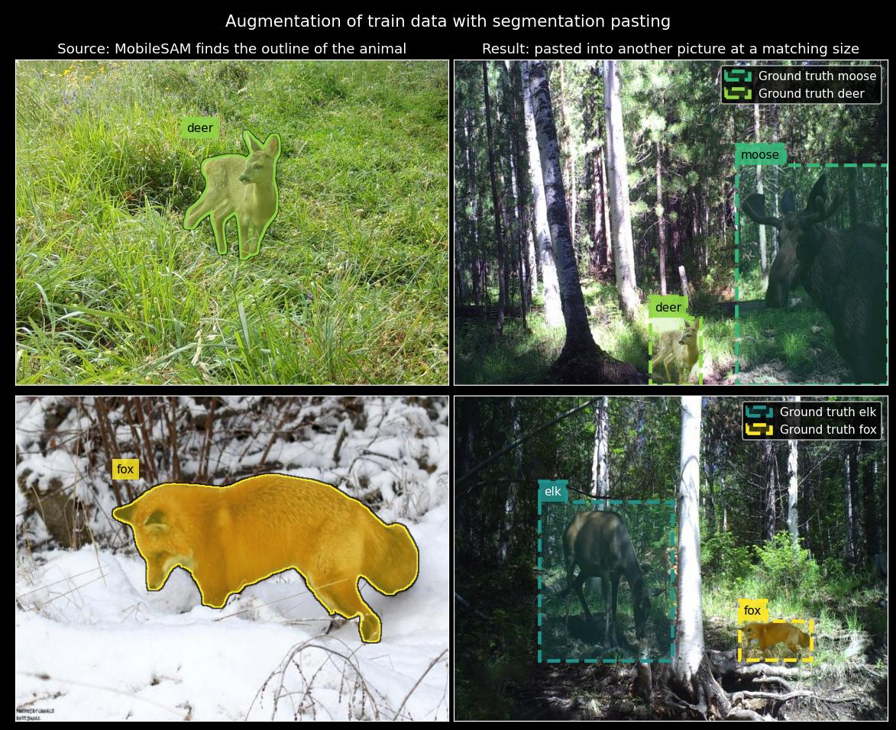
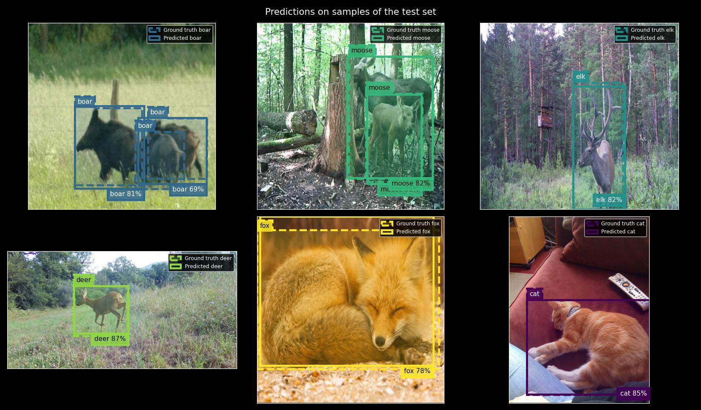
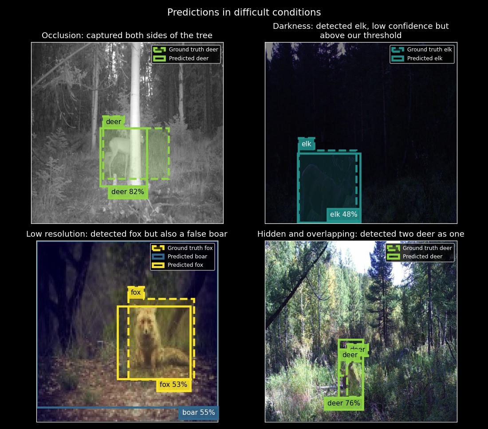
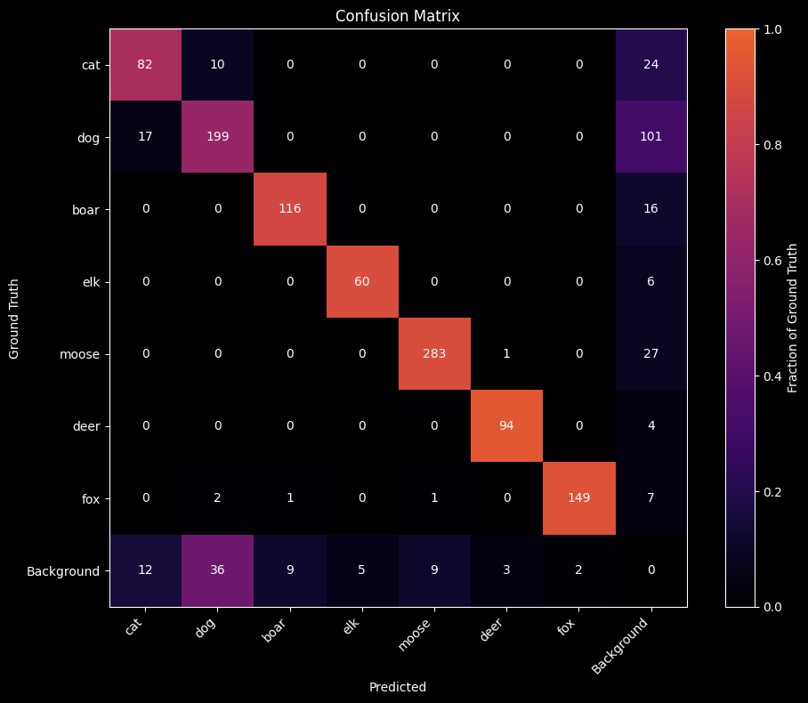
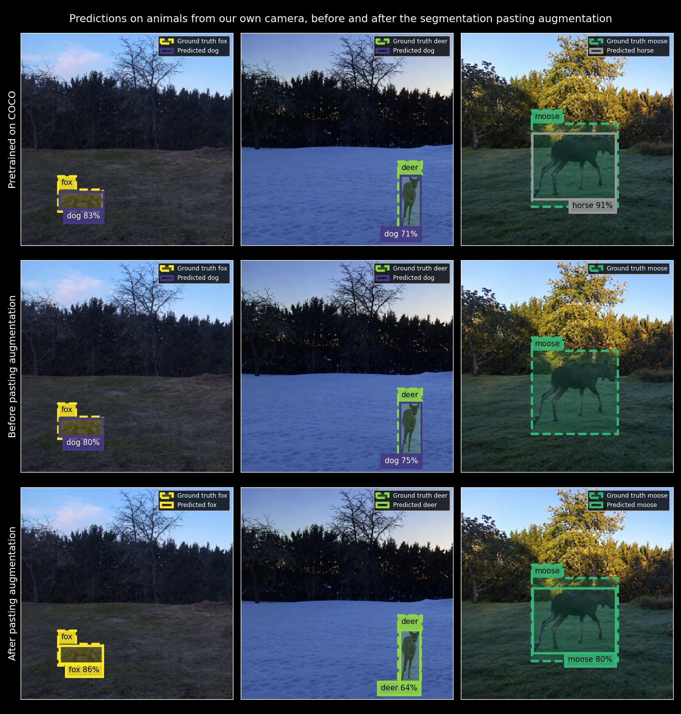

# Object detection

Two object detection projects, each documented as a Kaggle notebook.

| | Nordic animal detection | MRI brain tumor detection |
|---|---|---|
| Goal | Tell which animal passes a camera on a Raspberry Pi 3 | Understand object detection by building a detector from scratch |
| Model | YOLO26n, fine-tuned | Own model inspired by and compared with Ultralytics YOLOv5 |
| Test F1 score | 0.87 | 0.88 (own model), 0.89 (YOLOv5) |
| Summary | [docs/nordic-animal-detection.md](docs/nordic-animal-detection.md) | [docs/mri-detection.md](docs/mri-detection.md) |
| Notebook | [nordic-animal-detection.ipynb](nordic-animal-detection.ipynb) | [mri-detection.ipynb](mri-detection.ipynb) |
| Kaggle | [Open in Kaggle](https://www.kaggle.com/code/johndahlberg/nordic-animal-detection) | [Open in Kaggle](https://www.kaggle.com/code/johndahlberg/mri-brain-detection) |

## Nordic animal detection

A Raspberry Pi 3 with a camera, placed in the Nordic countryside, should tell which animal passes by. The Pi runs the model on its CPU, so the detector has to be the smallest YOLO model, YOLO26n at 640 px. It is fine-tuned to find boar, elk, moose, deer, fox, cat and dog.

A pretrained YOLO26n, used as it comes, already finds 13 of 18 animals on our own camera but names none of them: moose become horses, roe deer and foxes dogs. Fine-tuning on wildlife datasets first took work on the data: a camera info stripe that would have let the model cheat, a dataset without test images and bird boxes too small for a nano model to see. The first model then scored well on its test set, yet on our camera it called every animal a dog. The wildlife photos only show animals at close range, while our camera sees them small on a lawn. Animals cut out with a segmentation model and pasted into empty pictures from that camera, together with more daylight data, fixed most of it: 16 of 18 animals on the camera are now named correctly. On the test set the model reaches a precision of 0.90 and a recall of 0.84.

As a final test on real footage, the pretrained model, the first model and the final one run on pictures from our own camera.

Read the full summary in [docs/nordic-animal-detection.md](docs/nordic-animal-detection.md).

## MRI brain tumor detection

Localizing and classifying brain tumours with bounding boxes on a brain MRI data set. The model, data augmentation and loss are written from scratch in PyTorch, inspired by Ultralytics YOLOv5, to get a better understanding of the object detection task. The focus is on explainable code and visualizations more than on matching the original's performance.

The own model reaches a precision of 0.90 and a recall of 0.85 on the test set. An Ultralytics YOLOv5 model trained on the same data for comparison reaches 0.88 and 0.90.

Read the full summary in [docs/mri-detection.md](docs/mri-detection.md).
