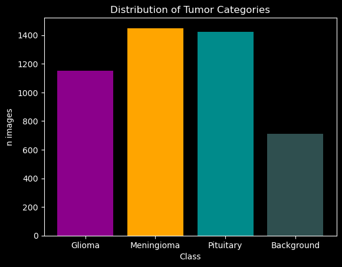
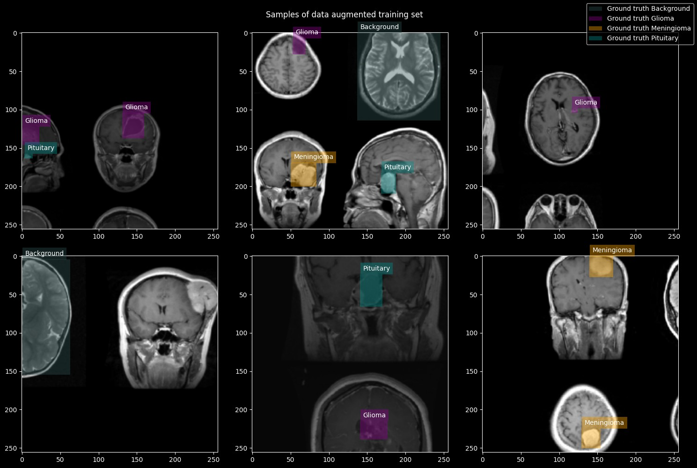
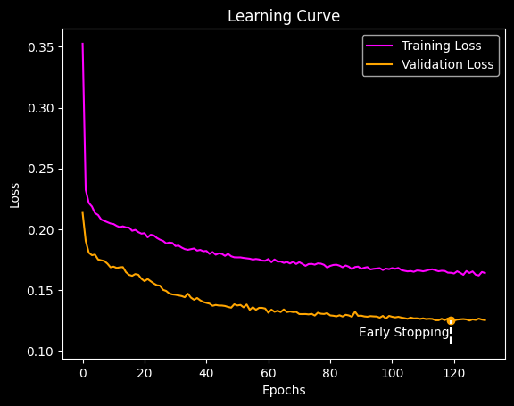
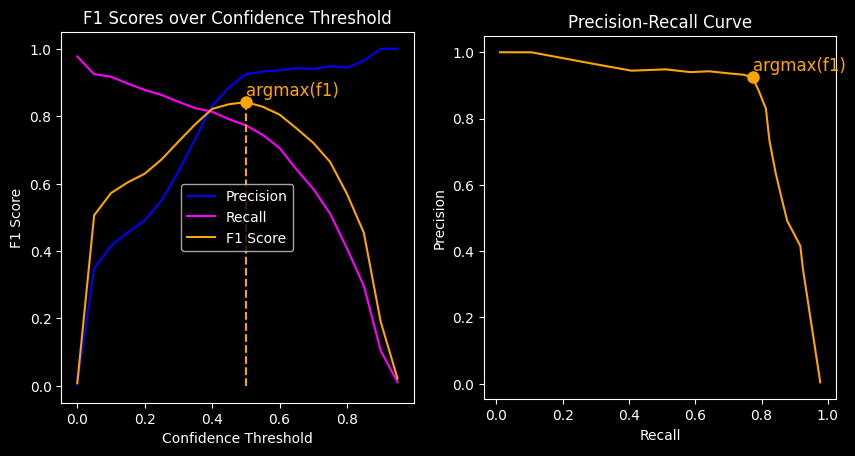
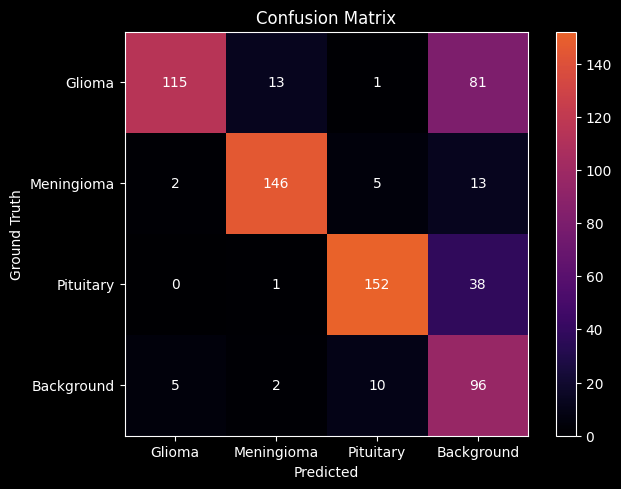
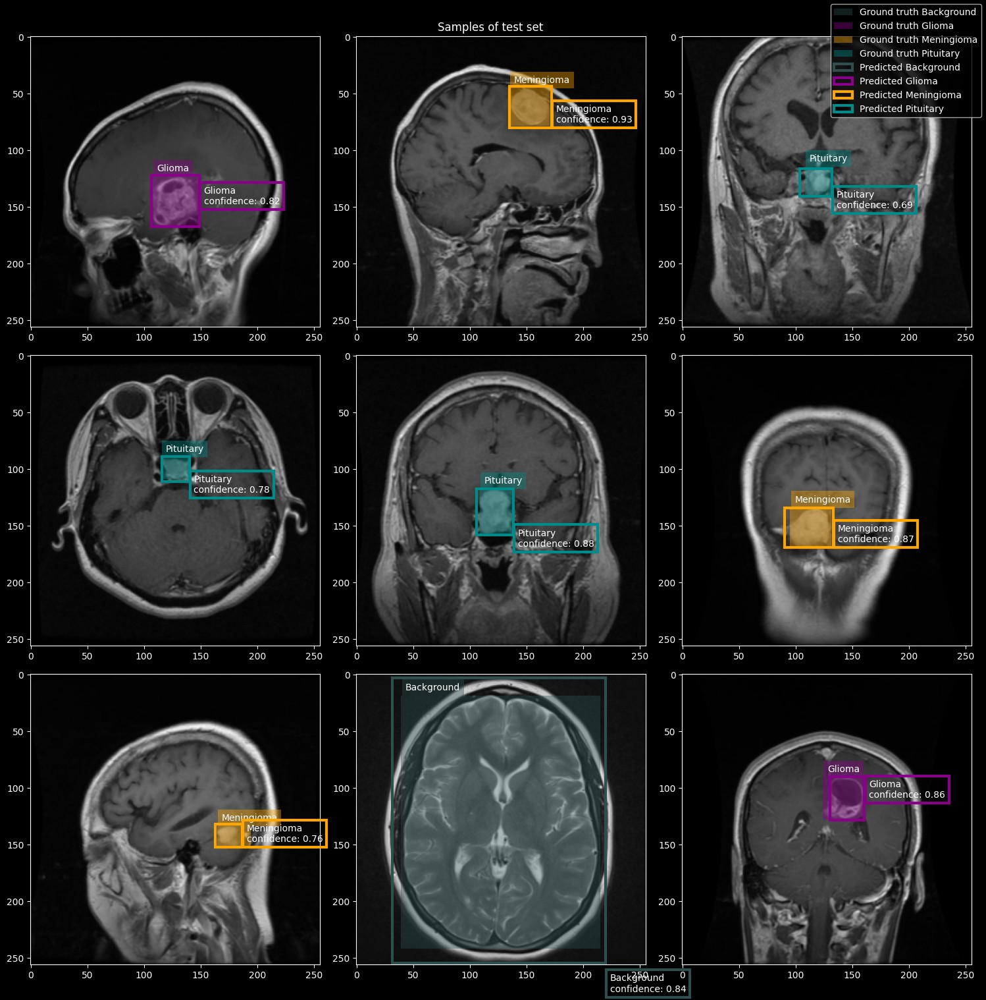
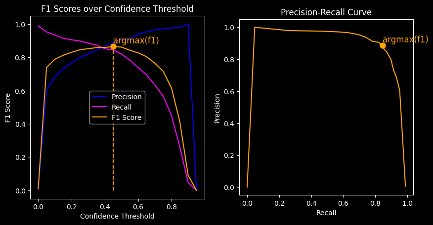
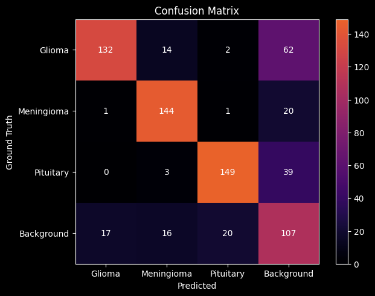

# MRI brain tumor detection

Summary of [mri-detection.ipynb](../mri-detection.ipynb). The notebook also runs on Kaggle: [Open in Kaggle](https://www.kaggle.com/code/johndahlberg/mri-brain-detection).

## Goal

The goal is to understand how an object detector works by building one from scratch in PyTorch, and to see how close it comes to an established detector trained on the same data.

* **The task.** Find brain tumors on MRI images, draw a box around each one and tell which of three types it is: glioma, meningioma or pituitary.
* **The approach.** The model, data augmentation and loss follow the ideas of [Ultralytics YOLOv5](https://docs.ultralytics.com/yolov5/). They are written again from its building blocks, not copied, so implementation and performance differ. Explainable code and visualizations come before matching the original's scores.
* **The comparison.** An Ultralytics YOLOv5 model (`yolov5mu`) is trained and evaluated on the same split.

## Data

The data set is [MRI for brain tumor with bounding boxes](https://www.kaggle.com/datasets/ahmedsorour1/mri-for-brain-tumor-with-bounding-boxes) with the tumor classes glioma, meningioma and pituitary, plus images without a tumor, which the notebook calls Background.

For the run on this page, the data set's own training and validation folders were merged and split again, image by image, into 3674 training, 787 validation and 788 test images. The notebook now splits by group instead, see [Changes for the next run](#changes-for-the-next-run).

A dataset class loads the images and boxes and resizes them to 256 px. For the training set it also augments: every training image is a mosaic of four images, which are flipped, scaled, shifted and changed in color.

## Model and training

* **Anchors.** Nine anchor box sizes, three per scale, are found with k-means clustering of the boxes in the validation set.
* **Model.** Written from the building blocks of YOLOv5: a CSP-Darknet backbone, a path aggregation network and a detection head on three scales, with 15.8 million parameters. It starts from random weights.
* **Loss.** The loss adds a box loss (complete IoU), an objectness loss and a class loss. The objectness target of a box is how well the predicted box overlaps the true one.
* **Prediction.** A box is kept when its objectness is above the confidence threshold. Overlapping boxes are then removed with non-maximum suppression at an IoU of 0.4, across all classes.
* **Optimizer.** SGD with a one-cycle learning rate schedule: the rate rises for 3 epochs to a peak of 0.04, falls back over the next 3 and then anneals along a cosine curve for the remaining epochs.
* **Stopping.** Training stops early when the validation loss has not improved for 10 epochs. The best model is from epoch 175, and training stopped 11 epochs later, short of the 200 allowed.

The validation loss falls from 0.207 to 0.110 by epoch 63, and only to 0.101 by epoch 175. It lies below the training loss for the whole run. The two are not directly comparable: training images are mosaics of four augmented images, while validation images are not augmented.

## Results

For each model the confidence threshold with the highest F1 score on the validation set is chosen, and the model is evaluated on the test set with it. A detection counts as correct when its box overlaps a true tumor box with an IoU of at least 0.4 and has the right class. Precision and recall count the three tumor classes only.

| Model | Parameters | Starting weights | Confidence threshold | Precision | Recall | F1 score |
|---|---|---|---|---|---|---|
| Own model | 15.8 million | random | 0.50 | 0.90 | 0.85 | 0.88 |
| Ultralytics YOLOv5 (`yolov5mu`) | 25.1 million | pretrained on COCO | 0.30 | 0.88 | 0.90 | 0.89 |

### Own model

Of the 750 tumor boxes in the test set, the own model finds 631 with the right class, gives 8 the wrong class and misses 111. It also makes 61 detections that match no tumor.

### Ultralytics YOLOv5 on the same data

Of the same 750 tumor boxes, YOLOv5 finds 670 with the right class, gives 6 the wrong class and misses 74. It makes 86 detections that match no tumor.

## Conclusions

* **The tumor types are told apart. Finding the tumor is the hard part.** Both models give a tumor the wrong type in about 1 of 100 cases: 8 of 750 for the own model, 6 for YOLOv5. Their errors are tumors that are missed, 111 and 74, and detections where there is no tumor, 61 and 86.
* **Glioma is missed most.** The own model misses 49 of 201 glioma boxes, against 23 of 248 meningioma and 39 of 301 pituitary. YOLOv5 also misses glioma most often, 30 of 201.
* **The own model needs a high threshold.** On the validation set its precision falls quickly when the threshold goes below 0.5, to about 0.6 at 0.3 and about 0.4 at 0.1. Its F1 score therefore peaks narrowly at 0.50 and is about 0.75 at 0.30. YOLOv5 keeps a precision of about 0.75 or more from a threshold of 0.05 up, and its F1 score stays close to its best between about 0.1 and 0.6. The own model's threshold has to be tuned with care, while YOLOv5's can be chosen loosely.
* **YOLOv5 buys recall with precision, and it had a head start.** At their best thresholds the two models end with almost the same F1 score, 0.88 and 0.89. YOLOv5 finds 39 more tumors and makes 23 more false positives, counting detections without a tumor and detections of the wrong type (92 against 69). So its recall is higher and its precision lower. The comparison is not equal. In the Ultralytics versions of the time, `pretrained=False` does not stop a model loaded from `yolov5mu.pt` from keeping its COCO weights, so YOLOv5 started pretrained while the own model started from random weights. YOLOv5 also has 60% more parameters, a head without anchors or objectness, and its own default non-maximum suppression (IoU 0.7, per class). The notebook does not show which of these makes the difference.

## Limits

* **Slices of one patient are in both training and test.** The data set has no patient ids, and consecutively numbered images can be neighboring slices of the same scan. The split shuffles single images, so the test set holds slices whose neighbors were trained on, and copies of training images. The test scores are therefore likely higher than they would be for a new patient. The notebook now removes the copies and splits by group.
* **The comparison with YOLOv5 is not like for like.** Starting weights, size, detection head and non-maximum suppression all differ, as described in the conclusions. The notebook now trains YOLOv5 from scratch, at our model's depth and width.
* **One run each.** Each model was trained once on one split, so an F1 difference of 0.01 does not show that either model is better.
* **Anchors come from the validation set.** The anchor sizes were clustered on the validation boxes, so the validation set, which also picks the threshold, shaped the model a little. The test set was not used for either.
* **Images without a tumor are not scored.** Precision and recall count tumor boxes only. Whether a model finds the Background box on an image without a tumor does not enter the scores, but a tumor predicted on such an image counts as a false positive.

## Changes for the next run

The notebook was changed after the run whose numbers this page shows. The numbers will be updated after a new Kaggle run. The test scores will likely drop, since the test set no longer holds copies of training images.

* **Copies removed, split by group.** A quarter of the images, 1336, are identical copies of another image, because the data set combines source collections that overlap. They are removed. The rest is grouped: neighboring slices of one scan that look alike, and the same slice found in two source collections, form one group. Whole groups are then split into 2736 training, 588 validation and 587 test images, with the classes balanced. The data set's own validation folder is not used as test set, since it shares copies and neighboring slices with its training folder.
* **How well the grouping works.** The data set has no patient ids, so the groups are found by comparing small grayscale copies of the images. With a split by image, about 73% of the test images have a training image with a similarity of 0.9 or more, almost the same picture. With the split by group it is 0.2%.
* **YOLOv5 from scratch, at our model's depth and width.** YOLOv5 is built from its model definition instead of the `yolov5mu.pt` checkpoint, so it starts from random weights like our model. It is scaled to depth 0.33 and width 0.75, the same backbone and neck sizes as our model, which gives 20.0 million parameters against our 15.8 million. The remaining difference is Ultralytics' larger detection head, which has no anchors.
* **Class chart.** The chart under Data is drawn with the corrected notebook cell. It used to pair the counts with the wrong class names.

## Next steps

* Log the box, objectness and class losses separately, to see how they develop against each other
* Compare predictions with and without non-maximum suppression, and at other IoU thresholds
* Improve hyper parameter search for better performance
* Pre-train model on other dataset
* Unit test code
