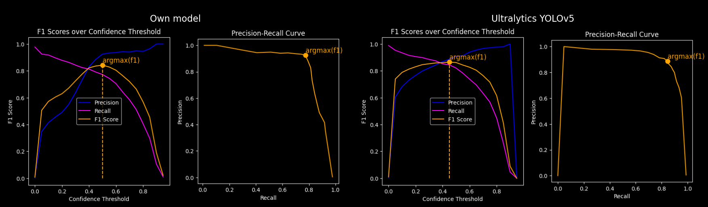
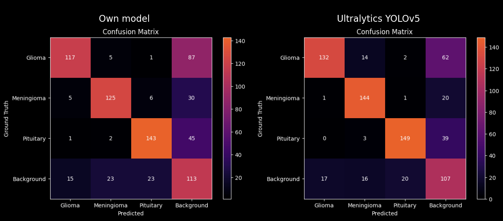
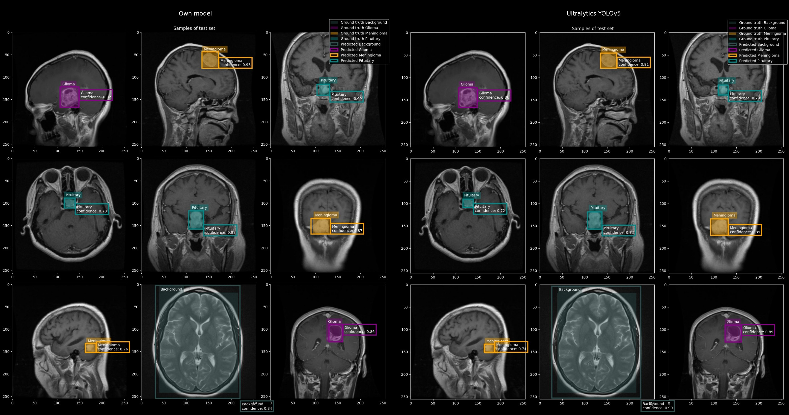
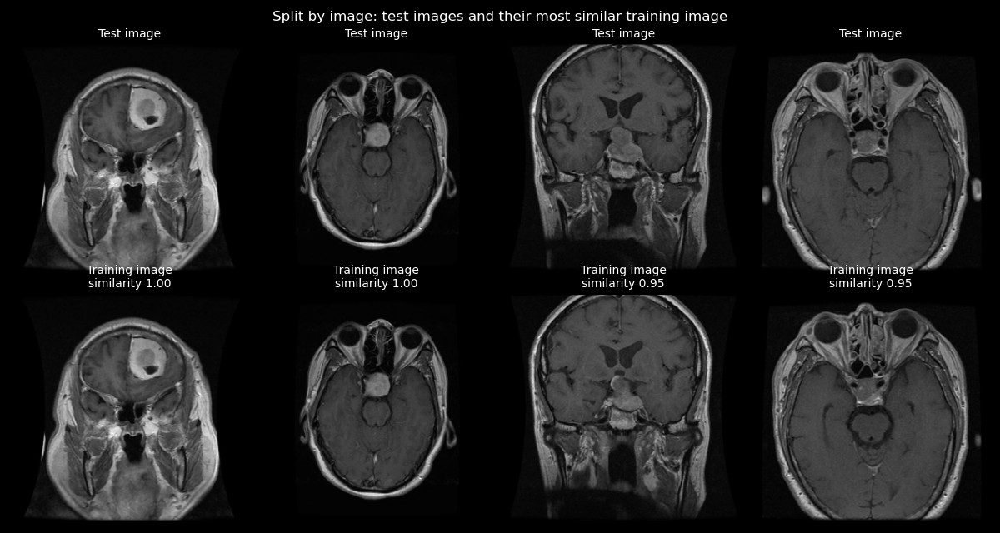
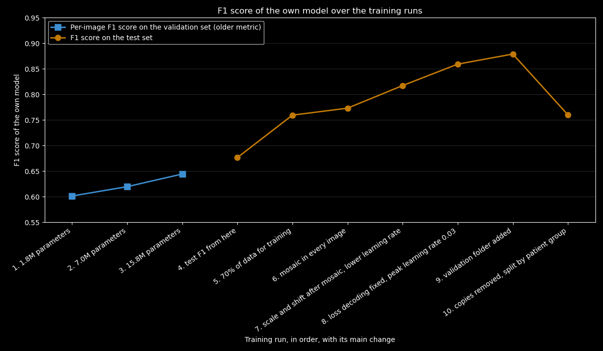
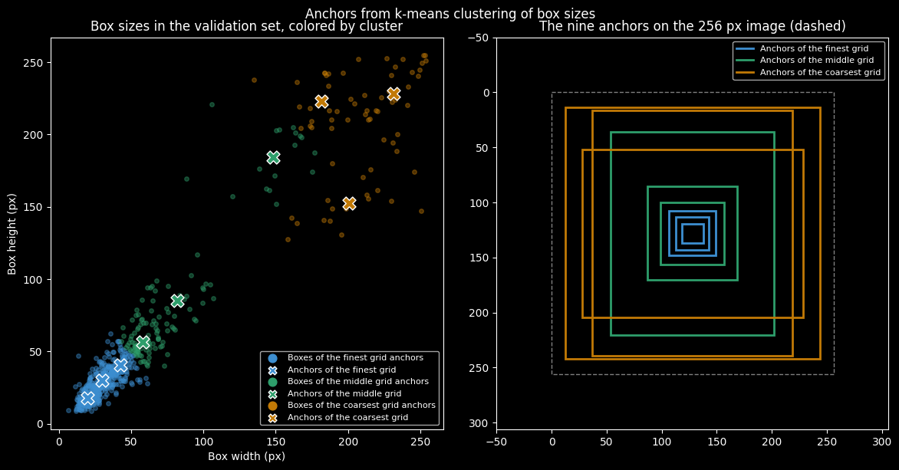
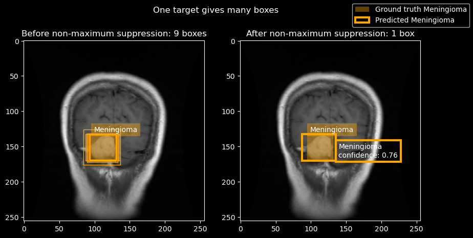

# MRI brain tumor detection

Summary of [mri-detection.ipynb](../mri-detection.ipynb). The notebook also runs on Kaggle: [Open in Kaggle](https://www.kaggle.com/code/johndahlberg/mri-brain-detection).

## Goal

The goal is to understand how an object detector works by building one from scratch in PyTorch, and to see how close it comes to an established detector trained on the same data.

* **The toy problem.** Brain tumors on MRI images are the problem to learn on: find each tumor, draw a box around it and tell which of three types it is, glioma, meningioma or pituitary.
* **The approach.** The model, data augmentation and loss are inspired by [Ultralytics YOLOv5](https://docs.ultralytics.com/yolov5/). They are written from scratch from its building blocks, so implementation and performance differ. Explainable code and visualizations come before matching the original's scores.
* **The comparison.** An Ultralytics YOLOv5 model is trained from scratch on the same split, scaled to the depth and width of our model.

## Data

The data set is [MRI for brain tumor with bounding boxes](https://www.kaggle.com/datasets/ahmedsorour1/mri-for-brain-tumor-with-bounding-boxes) with the tumor classes glioma, meningioma and pituitary, plus images without a tumor, which the notebook calls Background.

**Copies are removed.** The data set combines source collections that overlap, so about a quarter of its images are identical copies of another image. Only one of each is kept.

**The split keeps a patient in one set.** Neighboring slices of one patient's scan look alike, and the data set has no patient ids. Images are therefore grouped by similarity, and whole groups are split into training, validation and test sets.

A dataset class loads the images and boxes and resizes them to 256 px. For the training set it also augments: every training image is a mosaic of four images, which are flipped, scaled, shifted and changed in color.


## Model and training

* **Anchors.** Nine anchor box sizes, three per scale, are found with k-means clustering of the boxes in the validation set, the Background boxes included.
* **Model.** Written from the building blocks of YOLOv5: a CSP-Darknet backbone, a path aggregation network and a detection head on three scales, with 15.8 million parameters. It starts from random weights.
* **Predictions.** The head looks at the image as three grids, 32, 16 and 8 cells across. In every cell, each of the three anchors of that grid predicts a box, an objectness score and class scores, about 4000 predictions per image.
* **Loss.** The loss has three parts. The box loss (complete IoU) measures how well a predicted box covers its target. The class loss (cross-entropy) measures whether the predicted class is right. The objectness loss trains a score for every anchor in every grid cell that says whether a target is there. For an anchor assigned to a target, the score is trained toward the complete IoU of its predicted box with the target, never below zero, and for all other anchors toward zero, with binary cross-entropy. The objectness loss is weighted per scale.
* **Prediction.** A box is kept when its objectness is above the confidence threshold. Overlapping boxes are then removed with non-maximum suppression at an IoU of 0.4, across all classes.
* **Optimizer.** SGD with momentum and a one-cycle learning rate schedule: the rate rises for 3 epochs to its peak, falls back over the next 3 and then anneals along a cosine curve for the remaining epochs. I chose SGD because, with a carefully chosen learning rate, it is often reported to reach better results than adaptive optimizers such as Adam, at the price of being sensitive to that rate.
* **Stopping.** Training stops early when the validation loss has not improved for 10 epochs.

## Results: our model against Ultralytics YOLOv5

Both models are trained from random weights on the same split and evaluated with the same code. YOLOv5 is built from the Ultralytics model definition, scaled to the depth and width of our model, which makes its backbone and neck identical to ours, and trained with the same image size, batch size, number of epochs and patience, otherwise with Ultralytics' own settings. For each model the confidence threshold with the highest F1 score on the validation set is used on the test set. A detection counts as correct when its box overlaps a true box with an IoU of at least 0.4 and has the right class.

Precision is the share of a model's detections that are correct, and recall the share of true tumors it finds. The F1 score combines the two and is only high when both are:

```math
\text{precision} = \frac{TP}{TP + FP} \qquad \text{recall} = \frac{TP}{TP + FN} \qquad F_1 = \frac{2 \cdot \text{precision} \cdot \text{recall}}{\text{precision} + \text{recall}}
```

$TP$ counts tumors found with the right class, $FP$ detections that match no tumor or give it the wrong class, and $FN$ tumors that are missed. A higher confidence threshold removes uncertain detections, so precision usually rises and recall falls, as the F1 curves below show for both models.

| | Own model | Ultralytics YOLOv5 |
|---|---|---|
| Backbone and neck | CSP-Darknet and path aggregation network, depth 0.33, width 0.75 | identical |
| Detection head | one convolution per scale, 3 anchors, box, objectness and class per anchor | separate box and class branches, no anchors, no objectness |
| Assigning targets to predictions | own cell plus up to two neighbors, anchors of similar shape, all scales | task-aligned assigner |
| Box loss | complete IoU | complete IoU plus distribution focal loss |
| Confidence | objectness | class score |
| Non-maximum suppression | IoU 0.4, across classes | IoU 0.7, per class |
| Optimizer | SGD, one-cycle schedule | AdamW with a linearly falling learning rate, chosen automatically by Ultralytics for short runs |
| Augmentation | mosaic, flips, scaling, shifting and color changes | Ultralytics' own: mosaic, flips, scaling, shifting and color changes, no mosaic in the last 10 epochs |
| Parameters | 15.8 million, of which 36 thousand in the head | 20.0 million, of which 4.2 million in the head |
| Confidence threshold | 0.45 | 0.45 |
| Precision | 0.83 | 0.85 |
| Recall | 0.70 | 0.78 |
| F1 score | 0.76 | 0.81 |

Both models rarely give a tumor the wrong type. Their errors are mostly missed tumors, most often glioma, as the confusion matrices show.

**F1, precision and recall over the confidence threshold, validation set**



**Confusion matrices, test set**



**Predictions on test samples**



### The first scores were too good

An earlier run scored an F1 score of 0.88 for our model and 0.89 for YOLOv5. The cause was both the data set and how the notebook used it. The data set combines overlapping source collections, so a quarter of its images are copies, and neighboring slices of one patient look almost the same. Split image by image, they landed in both training and test: 42% of the test images had an almost identical training image (a similarity of 0.97 or more). Even the data set's own split shares 213 groups of identical files between training and validation.



With copies removed and each patient kept in one set (see Data), the scores dropped to 0.76 and 0.81. For YOLOv5 the drop also includes the switch from pretrained to random weights and to a smaller size. The chart shows our model's score over the training runs, and the drop when the leak was closed.



## What building it taught me

The goal was to learn how a detector works by writing one. These are the lessons that the code and the runs show.

### The model

* **Which predictions learn a target is a design choice.** During training, each labeled box has to be handed to some of the predictions, which then learn to output it, while all other predictions learn that nothing is there. Here a target goes to the cell of its center and up to two neighboring cells, for each anchor of similar shape, on every grid. This choice shapes what each part of the head learns, and it is why one target gets several almost identical boxes.
* **The box encoding must be bounded.** The head predicts positions and sizes through a sigmoid. A box center can lie from half a cell left of or above its grid cell up to the cell's right or lower edge, and a box size stays between 1 and about 4.5 times its anchor. The loss also clamps box sizes as a guard against exploding values. The bounds have to fit the way targets are assigned to grid cells, and here they do not everywhere, see Limits.
* **Anchors are priors taken from the data.** k-means clustering of the box sizes gives nine anchor shapes, three per scale. A target only trains the anchors whose shape is close to its own, so the anchors decide which targets each scale learns to find. Here the clustering placed five of the nine anchors on the Background boxes around whole brains, which are 14% of the boxes, and only four among the tumor boxes.



### Training

* **The three losses need balancing.** The box loss, the objectness loss and the class loss each get their own weight, and the objectness loss is weighted again per scale, highest on the finest grid.
* **Model size made little difference in the early runs.** In the commit history, growing the model from 1.8 to 7.0 and 15.8 million parameters moved the per-image F1 score on the validation set only from 0.60 to 0.64, with the learning rate, augmentation, loss weights and seed changing along with the size. The later changes to training and data raised the test F1 score from 0.68 to 0.88 at 15.8 million parameters, as the F1 chart under Results shows run by run. The first three runs had no test set yet, so they are scored on the validation set with an older metric. Each point is a single run, and the test set changed with the data.

### Overlapping boxes

* **One target gives many boxes.** Because one target trains several grid cells, anchors and scales, the model answers it with several boxes that almost overlap. Non-maximum suppression keeps the box with the highest objectness, which is the model's own estimate of the best IoU with the target, and removes the others that overlap it with an IoU of more than 0.4. A duplicate that survives counts as a false positive, since the evaluation matches each true box with one prediction only.
* **Close targets can be suppressed.** The suppression works across classes, so a second, real target that overlaps the first with an IoU of more than 0.4 is removed as if it were a duplicate. Ultralytics suppresses per class, and only above an IoU of 0.7.



### Evaluation and data

* **Evaluation is a design.** Precision and recall come out of choices I had to make: each true box is matched with at most one prediction, a match needs an IoU of 0.4, a target given the wrong class counts as a false positive but not as a missed target, finding the Background box on an image without a tumor is not scored, and the confidence threshold is the one with the best F1 score on the validation set. Other choices give other numbers for the same predictions.
* **Confidence is a choice.** The confidence here is the objectness score, which is trained toward how well the box overlaps the target, not a class score. Its threshold has to be tuned with care: the own model's F1 curve has a narrow peak, while YOLOv5, which scores boxes by class, stays close to its best over a wide range of thresholds (see the F1 curves under Results). Whether the kind of score causes this difference is not tested.
* **Data can leak between splits.** Copies and neighboring slices of one patient in both training and test made the first scores look much better than they were, as shown under Results. A split has to keep together whatever belongs together, here the slices of one patient.

## Limits

* **The grouping is a heuristic.** Without patient ids, groups are found from file numbers and image similarity. Slices of one patient that look less alike can still end up in different sets.
* **The comparison with YOLOv5 does not isolate a cause.** Detection head, assignment, loss, confidence, non-maximum suppression and training settings all differ at once.
* **Some assigned cells cannot reach their target.** A target is assigned to the grid cell of its center and to up to two neighboring cells. A target in the left or upper half of its cell is also assigned to the neighbor cell to the left or above. From there its center lies 1 to 1.5 cells away, but the encoding only reaches 1 cell, so that neighbor can never place the box exactly. YOLOv5's range, from -0.5 to 1.5 cells, covers it.
* **Boxes of non-square images are distorted.** The resize step scales the x coordinates of a box by the height ratio and the y coordinates by the width ratio. For the 13% of images that are not square, every true box is stretched and shifted, both as a training target for our model and as the ground truth both models are scored against. Fixed in the notebook for the next run.
* **Boxes are not clipped at the right and lower edge.** The clipping writes into a copy of the coordinates, so it has no effect. The distorted boxes therefore stay larger than the image: 23 validation boxes reach past it, which is why the largest anchor is taller than the image. Fixed in the notebook for the next run.
* **Box sizes cannot shrink below their anchor.** The size encoding allows 1 to about 4.5 times the anchor, while a target down to a quarter of an anchor's size is still assigned to it. Such a target can only be fitted by a larger box.
* **One run each.** Each model was trained once on one split, so differences of a few hundredths may not repeat with another seed. The earlier runs from the commit history on this page also ran once each, on the old split by image.
* **Our model is evaluated in training mode.** The notebook never switches our model to evaluation mode, so BatchNorm normalizes each image with the statistics of its batch of 32 validation or test images instead of the statistics learned in training. Its scores and predictions therefore depend on which images share a batch. YOLOv5 is evaluated in evaluation mode. Measured locally with the same weights, evaluation mode changes little: the threshold chosen on the validation set becomes 0.50, and the test F1 score goes from 0.760 to 0.764. Fixed in the notebook for the next run.
* **Anchors come from the validation set.** The anchor sizes were clustered on the validation boxes, so the validation set, which also picks the threshold, shaped the model a little. The test set was not used for either.
* **Images without a tumor are not scored.** Precision and recall count tumor boxes only. Whether a model finds the Background box on an image without a tumor does not enter the scores, but a tumor predicted on such an image counts as a false positive.

## Next steps

* Log the box, objectness and class losses separately, to see how they develop against each other
* Compare predictions with and without non-maximum suppression, and at other IoU thresholds
* Improve hyper parameter search for better performance
* Pre-train model on other dataset
* Unit test code
