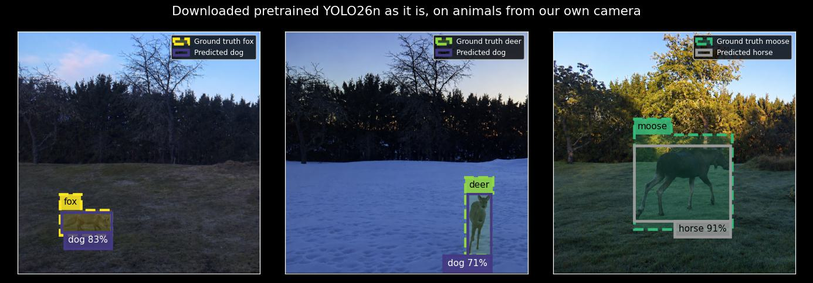
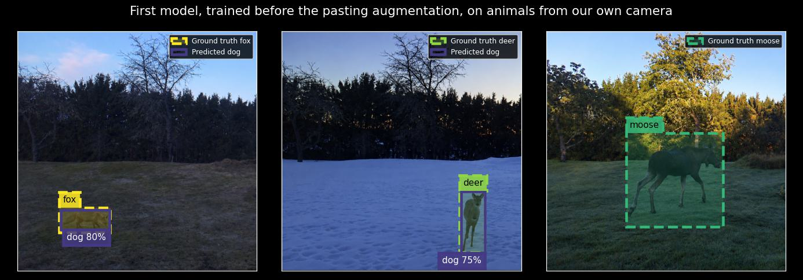
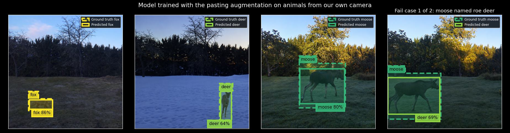

# Nordic animal detection

The code is open source in [nordic-animal-detection.ipynb](../nordic-animal-detection.ipynb), which also runs on Kaggle: [Open in Kaggle](https://www.kaggle.com/code/johndahlberg/nordic-animal-detection).

## Goal

A camera placed in the Nordic countryside should tell which animal passes by. It runs on a Raspberry Pi 3, a cheap computer with low power consumption, instead of a heavy GPU setup.

* **The constraint.** The Pi runs the model on its CPU, where even the smallest YOLO model needs seconds per image. So the model has to be YOLO26n at 640 px. A larger model or a higher resolution is not an option.
* **The classes.** The wild animals boar, elk, moose, deer and fox, and the pets cat and dog. Bird starts out as a class, is evaluated, and is dropped along the way.

## A first prototype in one line

Before collecting any data, the simplest thing is a one-liner: download YOLO26n pretrained on COCO and run it as it is.

```python
YOLO("yolo26n.pt").predict(frame, conf=0.40)
```

It is tested on 18 manually labeled pictures of animals from our own camera, from about six animal visits: 9 moose, 6 roe deer and 3 foxes. They are never used for training. The three shown in the figures are also cropped, levelled and mirrored, and a windmill is retouched out.

COCO has cat, dog, horse, cow and bear, but no moose, deer or fox. The pretrained model finds 13 of the 18 animals and names none of them correctly: moose become horses, roe deer and foxes become dogs.



So if all we wanted was to catch the moments when an animal passes, the pretrained model would almost do: it misses some animals and names the rest wrong. To tell a moose from a roe deer, it has to be fine-tuned on our classes.

## Data

The data combines a subset of COCO (bird, cat, dog) with wildlife datasets from Roboflow.

* **Wild-deer** brings elk, moose, roe deer and boar from trail cameras, many of them infrared night shots.
* **Wildlife** brings boar and **Animal Detection** brings fox, mostly as ordinary daytime photos. Its fox class also holds other fox species and a few jackals or coyotes. None of them live here, so they only widen what the model takes for a fox.

Two more datasets, added later as part of the solution, are already included in the figures below.


COCO and the Wildlife dataset are split into 80% train, 10% validation and 10% test. The other datasets keep their Roboflow split, because Roboflow adds augmented copies to the training images only. Shuffling them again would put copies of the same photo in both train and test.


## Problems found in the data

**The camera stripe gives away the answer.** The trail cameras stamp a stripe with a logo at the bottom of every image. No other class has it, so a model can learn "stripe means elk, moose or deer" instead of looking at the animal. The stripe is cropped from every such image, by an amount found for each image. The Italian cameras, added later, have a stripe of their own, which is cropped the same way. Some rotated training copies keep a tilted sliver of the stripe. Validation and test images end up clean, so that sliver cannot improve the scores.


**Training samples.** These are loaded the way the training loads them, with its augmentation: mosaic combines four images into one, and images are flipped, scaled and shifted.


**COCO boxes the model cannot see.** Before training, the pretrained YOLO26n was run on our COCO validation images. How many labeled animals it finds depends strongly on box size. Of the bird boxes below 16 px it finds 2 of 97. Of those at 96 px and above it finds 23 of 28. This model has already seen all of COCO, so more data would not change that.


COCO images with a crowd box (133) or with any box below 32 px (744) are therefore removed. Whole images are removed, not single labels, so that no visible animal is left unlabeled, which would confuse the model.

**Bird is dropped.** After that pruning only 273 training, 44 validation and 44 test images with birds are left, and a nano model at 640 px would only find large, clearly visible birds. Bird labels are removed (553 boxes), together with the 347 images that only contained birds.

## Training

YOLO26n pretrained on COCO is fine-tuned with all layers trainable, since trail camera images, many of them infrared night shots, look different from COCO photos. Augmentation uses mosaic, horizontal flips, scaling, translation and mild color changes. Training stops early when the validation score has not improved for 15 epochs.

## Results on the test set

The first model looks good on its test set. With the confidence threshold that gives the highest F1 score on the validation set, it reaches:

| Model | Precision | Recall | F1 score |
|---|---|---|---|
| First model | 0.89 | 0.78 | 0.83 |

The figures in this section come from the final model, trained with the changes described further down. On the test set it behaves much like the first model, so the figures are shown only once.


* **The wild animals are told apart.** Boar, elk, moose, deer and fox are almost never mistaken for each other.
* **Cats and dogs get mixed up.** 10 cats are predicted as dogs and 17 dogs as cats. That is acceptable for this use, since both are pets.
* **Cats and dogs are missed most often.** 24 of 116 cats and 101 of 317 dogs are not found at all. Of the wild animals, 16 of 132 boar and 27 of 311 moose are missed, and elk, deer and fox only rarely.

The predictions on samples of the test set look good as well: the boxes sit on the animals and name them correctly. Only one of the three boar is missed.


**Difficult conditions.** In the first row the model copes: its box covers the roe deer on both sides of the tree, and it detects the elk at night, made darker still for this figure, at 48%, low but above our threshold of 0.40. The second row shows its limits: in a blurry low-resolution picture it detects the fox but also a boar over almost the whole picture, and two roe deer that overlap in the vegetation are detected as one.


## But does it work on our own camera?

A good test score shows that the model works on pictures like the ones it was trained on. Our camera does not take pictures like those. So the real test is the 18 animals from our own camera.

This time it finds 14 of the 18 animals, one more than the pretrained model, but still names none of them correctly, calling every one of them a *dog*!



**Why? Wild animals are only large.** Our camera looks out over an open lawn, where a roe deer or a fox covers 1-2% of the picture. The wildlife photos show animals at close range. In the training set it is rare for a wild animal to cover less than 2% of the image, and most common for dogs, so the model learned "a small animal in a wide scene is a dog". The test set comes from the same sources as the training data, so it could not show this.


## Solution: segmentation pasting into our own scenes

**Augmentation of train data with segmentation pasting.** Animals from the training set are pasted, proportionally small, into empty pictures from our own camera. A segmentation model, MobileSAM, turns the box of an animal into its outline, so that no rectangle of forest comes along. The pasted size follows the place on the lawn and the species: further up the lawn is further away and smaller, and at the same place a moose is about twice as tall as a roe deer. All classes are pasted, and some empty pictures are added unchanged as scenes without any animal. Training also scales every image to between 0.4 and 1.6 times its size.

The figure shows the steps on public training images, with the pasted animal sized relative to the animal that is already there.


**More data where it was thin.** Two more datasets fill the gaps the camera test showed: **moose-detection-8-cl-v2** by test-q5dxc brings moose in daylight, where the other moose are mostly gray infrared shots, and **DS** by l-ras brings roe deer, fox and boar from Italian trail cameras. Both are licensed CC BY 4.0.

## Final results

The final run stopped early after 146 epochs. The early stopping weights from epoch 131 are kept, where the validation mAP50-95 peaks at 0.720. Towards the end the validation loss levels off while the training loss keeps falling.


The best threshold on the validation set is now 0.40. On the test set the final model gains a little on the first one:

| Model | Precision | Recall | F1 score |
|---|---|---|---|
| First model | 0.89 | 0.78 | 0.83 |
| Final model | 0.90 | 0.84 | 0.87 |

On our own camera the difference is large. The final model names 16 of the 18 animals correctly: all 3 foxes, all 6 roe deer and 7 of 9 moose. One moose is called a roe deer, shown on the right, and one, of which only the legs show at the edge of the picture, is missed.



## What about empty scenes?

Most of the time our camera sees no animal at all, and a model that sees animals there is of little use. So the real test also needs empty scenes: 108 pictures from our camera without any animal, never used for training.

All three models at 640 px and a threshold of 0.40. In every column, higher is better:

| Model | Animals found | Animals named correctly | Empty scenes left empty |
|---|---|---|---|
| Pretrained YOLO26n | 13 of 18 | 0 of 18 | 108 of 108 |
| First model | 14 of 18 | 0 of 18 | 105 of 108 |
| Final model | **17 of 18** | **16 of 18** | **108 of 108** |

The final model finds and names the animals without seeing animals where there are none.

## Limits

* On the Raspberry Pi 3, a YOLO26n at 640 px takes about 2 seconds per picture, so an animal that passes quickly is seen in few pictures or none.
* The trail camera images in train and test come from the same camera locations. The scores for elk, moose and deer tell how well the model works at locations it has seen, not at a new place.
* The test on our own camera rests on 18 pictures from a few visits, so a difference of one or two pictures says little.
* The 108 empty scenes come from the same weeks, that is the same season, as the empty pictures used for training, so for the final model they are easier than a new season would be.
* Animals that are none of our classes can still be detected: the final model calls one of two hares on our camera a dog.

## Next steps

* Collect and label more animals from our own camera, as an honest test set for it
* Train on the newly collected data
* Test on empty scenes from a new season
* Improve hyper parameter search for better performance
