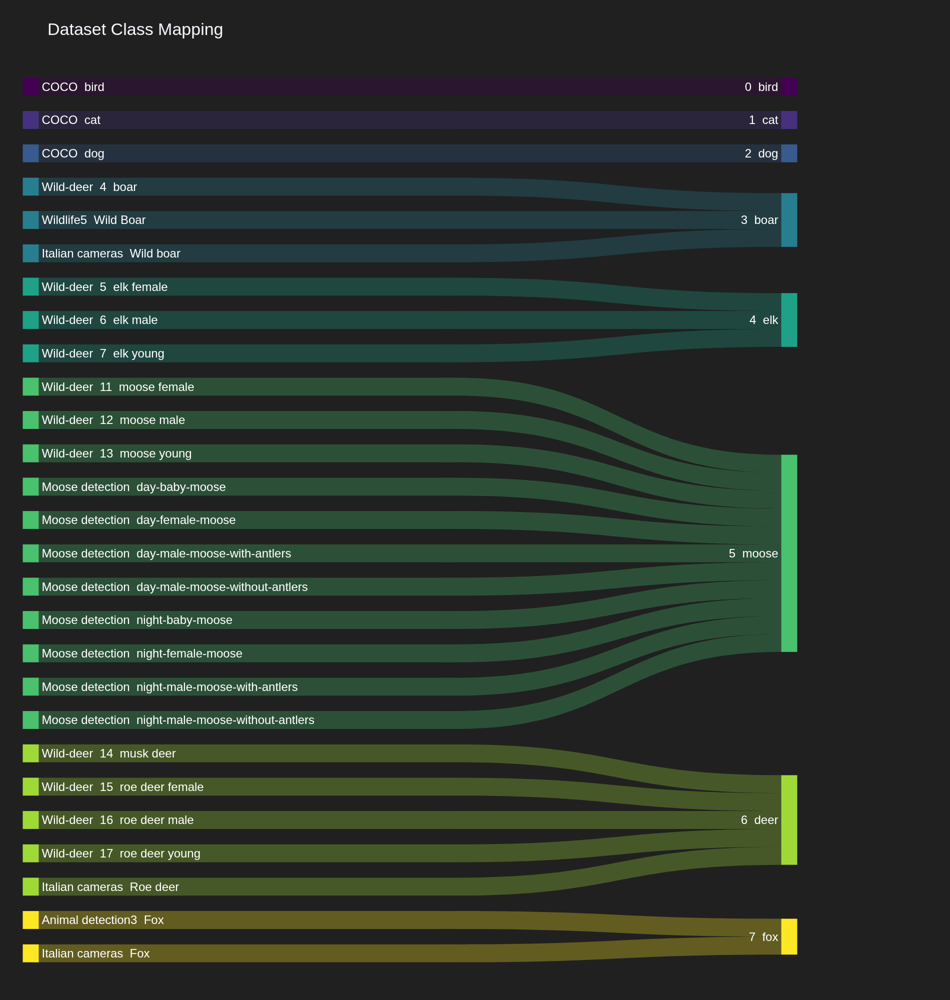
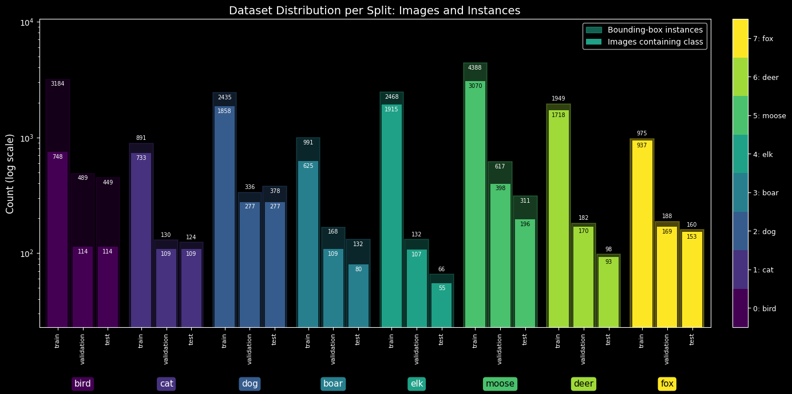
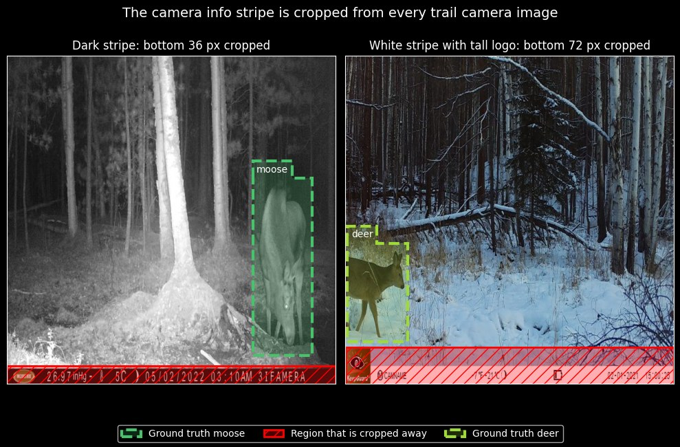
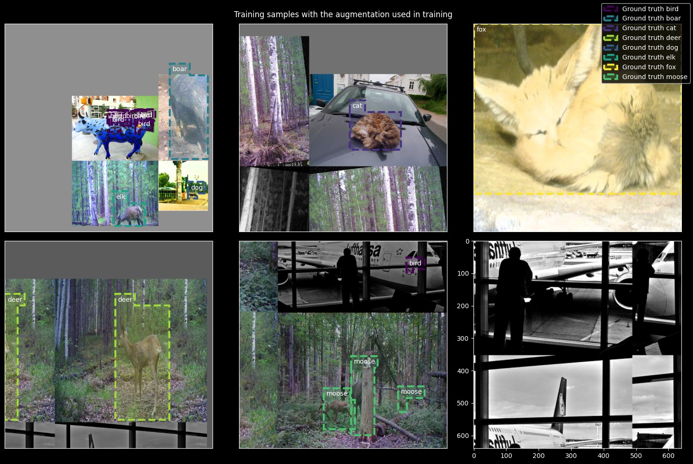
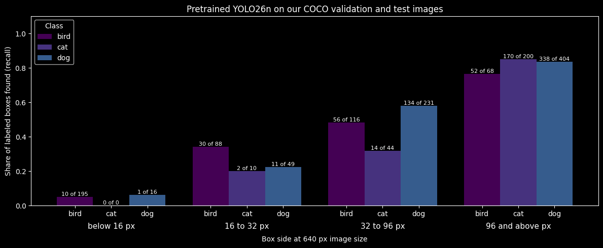
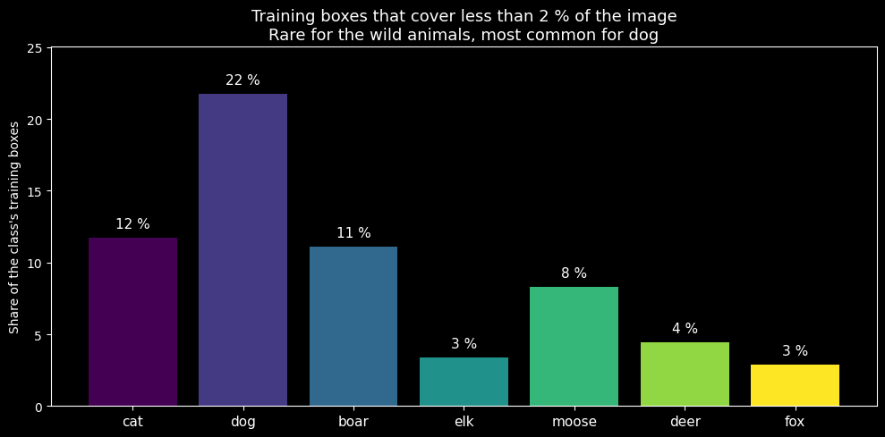
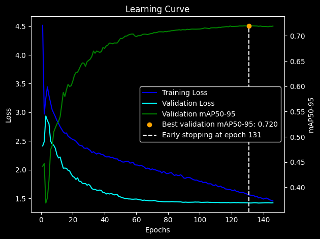
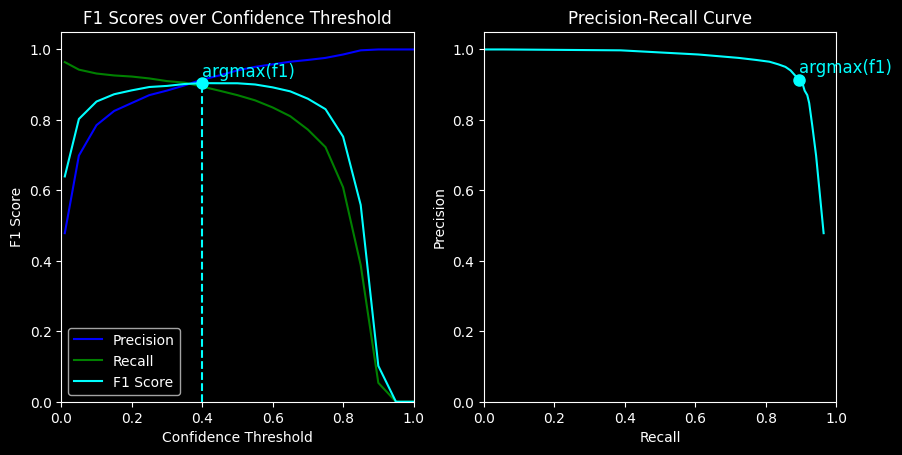

# Nordic animal detection

Summary of [nordic-animal-detection.ipynb](../nordic-animal-detection.ipynb). The notebook also runs on Kaggle: [Open in Kaggle](https://www.kaggle.com/code/johndahlberg/nordic-animal-detection).

## Goal

A Raspberry Pi 3 with a camera, placed in the Nordic countryside, should tell which animal passes by.

* **The constraint.** The Pi runs the model on its CPU, where even the smallest YOLO model needs several seconds per image. So the model has to be YOLO26n at 640 px. A larger model or a higher resolution is not an option.
* **The classes.** The wild animals boar, elk, moose, deer and fox, and the pets cat and dog. Bird starts out as a class, is evaluated, and is dropped along the way. Elk is used in the American sense, the red deer and wapiti, and deer means roe deer.

## Data

The data combines a subset of COCO (bird, cat, dog) with five wildlife datasets from Roboflow, and with pictures from our own camera.

* **Wild-deer** brings elk, moose, roe deer and boar from trail cameras, many of them infrared night shots.
* **Wildlife** brings boar and **Animal Detection** brings fox, mostly as ordinary daytime photos.
* **moose-detection-8-cl-v2** by test-q5dxc brings moose, among them moose in daylight, and **DS** by l-ras brings roe deer, fox and boar from Italian trail cameras. Both are licensed CC BY 4.0.
* **Our own camera** gives empty pictures of the lawn it looks at. They are private, so they are used for training but not shown.

COCO and the Wildlife dataset are split by us into 80% train, 10% validation and 10% test. The other datasets keep their Roboflow split, because Roboflow adds augmented copies to the training images only. Shuffling them again would put copies of the same photo in both train and test.

## Problems found in the data

**The camera stripe gives away the answer.** The trail cameras stamp a stripe with a logo at the bottom of every image. No other class has it, so a model can learn "stripe means elk, moose or deer" instead of looking at the animal. The stripe is cropped from every such image, by an amount found for each image. The Italian cameras have a stripe of their own, which is cropped the same way. Some rotated training copies keep a tilted sliver of the stripe. Validation and test images end up clean, so that sliver cannot improve the scores.

**Training samples.** These are loaded the way the training loads them, with its augmentation: mosaic combines four images into one, and images are flipped, scaled and shifted.

**COCO boxes the model cannot see.** Before training, the pretrained YOLO26n was run on our COCO validation and test images. How many labeled animals it finds depends strongly on box size. Of the bird boxes below 16 px it finds 10 of 195. Of those at 96 px and above it finds 52 of 68. This model has already seen all of COCO, so more data would not change that.

COCO images with a crowd box (133) or with any box below 32 px (744) are therefore removed. Whole images are removed, not single labels, so that no visible animal is left unlabeled.

**Bird is dropped.** After that pruning only 273 training, 44 validation and 44 test images with birds are left, and a nano model at 640 px would only find large, clearly visible birds. Bird labels are removed (553 boxes), together with the 347 images that only contained birds.

**Wild animals are only ever large.** Our camera looks out over an open lawn, where a roe deer or a fox covers 1 to 2% of the picture. The wildlife photos show animals at close range. In the training set it is rare for a wild animal to cover less than 2% of the image, and most common for dogs, so a model can learn "a small animal in a wide scene is a dog". That is what the first model did on our camera: it called every animal a dog.

**Augmentation of train data with segmentation pasting.** The remedy is to paste animals from the training set, small, into empty pictures from our camera. A segmentation model, MobileSAM, turns the box of an animal into its outline, so that no rectangle of forest comes along. The pasted size follows the place on the lawn and the species: further up the lawn is further away and smaller, and at the same place a moose is about twice as tall as a roe deer. All classes are pasted, cat and dog included, and some empty pictures are added unchanged as scenes without any animal. Training also scales every image to between 0.4 and 1.6 times its size.

Our camera pictures are private, so the figure shows the steps on public training images, with the pasted animal sized relative to the animal that is already there.

## Training

YOLO26n pretrained on COCO is fine-tuned with all layers trainable, since trail camera images, many of them infrared night shots, look different from COCO photos. Augmentation uses mosaic, horizontal flips, scaling, translation and mild color changes. Training stops early when the validation score has not improved for 15 epochs.

The run stopped after 146 epochs. The weights from epoch 131 are kept, where the validation mAP50-95 peaks at 0.720. Towards the end the validation loss levels off while the training loss keeps falling.

## Results

The confidence threshold with the highest F1 score on the validation set is 0.40. On the test set it gives:

| Precision | Recall | F1 score |
|---|---|---|
| 0.90 | 0.84 | 0.87 |

* **The wild animals are told apart.** Boar, elk, moose, deer and fox are almost never mistaken for each other.
* **Cats and dogs get mixed up.** 10 cats are predicted as dogs and 17 dogs as cats. That is acceptable for this use, since both are pets.
* **Cats and dogs are missed most often.** 24 of 116 cats and 101 of 317 dogs are not found at all. Of the wild animals, 16 of 132 boar and 27 of 311 moose are missed, and elk, deer and fox only rarely.

**Difficult conditions.** In the first row the model copes: its box covers the roe deer on both sides of the tree, and it detects the elk at night, made darker still for this figure, at 48%, low but above our threshold of 0.40. The second row shows its limits: in a blurry low-resolution picture it detects the fox but also a boar over almost the whole picture, and two roe deer that overlap in the vegetation are detected as one.

## Our own camera

The model was also tested on 18 pictures from our own camera, from about six animal visits. They are private and not shown. These pictures had their drawn overlay removed with an image generation tool, and their labels were set by us. Measured locally at 640 px and a threshold of 0.40, the model names 16 of the 18 animals correctly: all 3 foxes, all 6 roe deer and 7 of 9 moose. A model trained before the pasting got none of them right. Some sizes used for the pasting were measured on these same pictures, so this is not a fully independent test.

## Limits

* The model has not run on the Raspberry Pi. Its speed there is not measured.
* The trail camera images in train and test come from the same camera locations. The scores for elk, moose and deer tell how well the model works at locations it has seen, not at a new place.
* The test on our own camera rests on 18 pictures from a few visits, so a difference of one or two pictures says little.
* The fox class of the Animal Detection dataset also holds other fox species and a few jackals or coyotes.

## Next steps

* Run the model on the Raspberry Pi 3 and measure the time per image
* Collect and label more animals from our own camera, as an honest test set for it
* Review the fox class of the Animal Detection dataset
* Improve hyper parameter search for better performance
